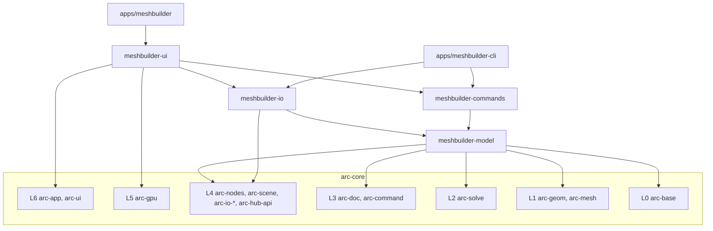

# MeshBuilder

Polygon and subdivision modeling, sculpting, texturing, rigging, animation, motion capture and effects
in one native application of the Arc suite.

> **Status: design phase.** No builds are available yet. This repository contains the product definition, architecture and roadmap that implementation follows.

## What it is

MeshBuilder is a digital content creation application in which modeling, sculpting, texture
painting, rigging, animation, motion-capture editing, simulation and scene assembly share one
document, one parallel evaluation graph and one procedural node system. Modifier stacks are a view of
that graph, direct edits bind to stable component identities, scenes are assembled with OpenUSD, and
materials are MaterialX graphs with OpenPBR surfaces. It is written in Rust, runs on Windows, macOS
and Linux on any vendor's GPU, works offline without an account, and renders through RenderBuilder.

## Who it is for

Modelers, character artists, riggers, animators, effects artists, look-development and lighting
artists, visualization artists working from ArchBuilder, SolidBuilder and CivilBuilder models, and
pipeline technical directors who automate all of it. See [vision](docs/product/vision.md).

## Capability areas

| Area | Scope | Specification |
|---|---|---|
| Scene and data model | Objects, transforms, hierarchy, duplication, layers, collections, evaluation | [01](docs/product/capabilities/01-scene-and-data-model.md) |
| Viewport and selection | Display, navigation, selection, manipulators, snapping | [02](docs/product/capabilities/02-viewport-and-selection.md) |
| Polygon modeling | Primitives and component operations | [03](docs/product/capabilities/03-polygon-modeling.md) |
| Subdivision surfaces | Schemes, levels, creases | [04](docs/product/capabilities/04-subdivision-surfaces.md) |
| Procedural modifiers | Modifier stack and modeling modifiers | [05](docs/product/capabilities/05-procedural-modifiers.md) |
| Geometry node graphs | Visual programming over geometry | [06](docs/product/capabilities/06-geometry-node-graphs.md) |
| Curves and NURBS | Curves, sweeps, lofts, NURBS surfaces | [07](docs/product/capabilities/07-curves-and-nurbs.md) |
| Booleans, retopology and clean-up | Booleans, remeshing, retopology, mesh checks | [08](docs/product/capabilities/08-booleans-retopology-and-cleanup.md) |
| UV editing | Unfolding, packing, texel density, UDIM | [09](docs/product/capabilities/09-uv-editing.md) |
| Vertex data and attributes | Attributes, normals, colors, transfer | [10](docs/product/capabilities/10-vertex-data-and-attributes.md) |
| Materials and look development | OpenPBR, MaterialX, textures, libraries | [11](docs/product/capabilities/11-materials-and-look-development.md) |
| Lights and cameras | Lights, environments, physical cameras | [12](docs/product/capabilities/12-lights-and-cameras.md) |
| Rendering integration | Viewport rendering, capture, RenderBuilder sessions, render setups | [13](docs/product/capabilities/13-rendering-integration.md) |
| Scene assembly and OpenUSD | Stages, layers, variants, publishing | [14](docs/product/capabilities/14-scene-assembly-and-usd.md) |
| References and asset management | References, overrides, Arc Scene links, libraries, Hub | [15](docs/product/capabilities/15-references-and-asset-management.md) |
| Pipeline interchange | Formats, conversion, loss reports | [16](docs/product/capabilities/16-pipeline-interchange.md) |
| Scripting and extensibility | Commands, automation protocol, Python, CLI, plug-ins | [17](docs/product/capabilities/17-scripting-and-extensibility.md) |
| Customization | Workspaces, shortcuts, menus, accessibility | [18](docs/product/capabilities/18-customization.md) |
| Color management and project settings | OpenColorIO, units, time, projects | [19](docs/product/capabilities/19-color-management-and-project-settings.md) |
| Rigging | Joints, solvers, constraints, controls | [20](docs/product/capabilities/20-rigging.md) |
| Skinning and deformation | Binding, weights, blend shapes, deformers | [21](docs/product/capabilities/21-skinning-and-deformation.md) |
| Keyframe animation | Keys, curves, shots | [22](docs/product/capabilities/22-keyframe-animation.md) |
| Nonlinear animation and layers | Clips, tracks, layers, takes | [23](docs/product/capabilities/23-nonlinear-animation-and-layers.md) |
| Motion capture and retargeting | Marker solving, full-body solver, live devices | [24](docs/product/capabilities/24-motion-capture-and-retargeting.md) |
| Sculpting | Brushes, multiresolution, layers | [25](docs/product/capabilities/25-sculpting.md) |
| Texture painting and baking | Paint layers, projection, baking | [26](docs/product/capabilities/26-texture-painting-and-baking.md) |
| Rigid, cloth and hair dynamics | Rigid and soft bodies, cloth, grooming | [27](docs/product/capabilities/27-rigid-cloth-and-hair-dynamics.md) |
| Particles, fluids and volumes | Particles, liquids, smoke, volumes | [28](docs/product/capabilities/28-particles-fluids-and-volumes.md) |
| Motion graphics and crowds | Procedural instancing, falloffs, crowds | [29](docs/product/capabilities/29-motion-graphics-and-crowds.md) |

## How it fits in the suite

MeshBuilder depends only on [`arc-core`](https://github.com/ACKaraca/arc-core) and cooperates with
other products at run time through the three suite contracts:

- **Arc document package**: the `.meshb` native document, and the format of referenced documents.
- **Arc Scene contract**: rendering through [RenderBuilder](https://github.com/ACKaraca/renderbuilder)
  and live links to models published by [ArchBuilder](https://github.com/ACKaraca/archbuilder),
  [SolidBuilder](https://github.com/ACKaraca/solidbuilder) and
  [CivilBuilder](https://github.com/ACKaraca/civilbuilder).
- **Hub API**: versioning, production tracking, render queue and multi-user editing through
  [Arc Hub](https://github.com/ACKaraca/arc-hub).

## Architecture at a glance

Details: [architecture overview](docs/architecture/overview.md),
[evaluation model](docs/architecture/evaluation.md),
[scene and USD](docs/architecture/scene-and-usd.md).

## Roadmap summary

| Milestone | Suite phase | Theme |
|---|---|---|
| M1 | 4 | Scene, viewport and polygon core |
| M2 | 4 | Non-destructive modeling: modifiers, subdivision, graphs, curves |
| M3 | 4 | UV, attributes, materials, lights, rendering and interchange |
| M4 | 4 | Rigging and animation |
| M5 | 4 | Scene assembly, references and pipeline |
| M6 | 5 | Sculpting, texture painting and baking |
| M7 | 5 | Motion capture, dynamics, effects and motion graphics |
| M8 | 5 | Depth and scale: collaboration, plug-ins, advanced modeling |

See the [roadmap](docs/roadmap.md).

## Documentation

The [documentation map](docs/README.md) lists every document. Automated agents start with
[AGENTS.md](AGENTS.md).

## Contributing

Read [CONTRIBUTING.md](CONTRIBUTING.md). Work starts from an issue that names the capability
identifiers it implements. Security reports follow [SECURITY.md](SECURITY.md).

## License

Licensed under the [Apache License 2.0](LICENSE). See [NOTICE](NOTICE).

## Trademarks

Arc, ArchBuilder, DraftBuilder, CivilBuilder, SolidBuilder, MeshBuilder, RenderBuilder, Arc Review and Arc Hub are names of this project and are not covered by the Apache License; see the [trademark policy](https://github.com/ACKaraca/arc-suite/blob/main/TRADEMARKS.md). All other product and company names are trademarks of their respective owners and are used only to describe scope and interoperability.
