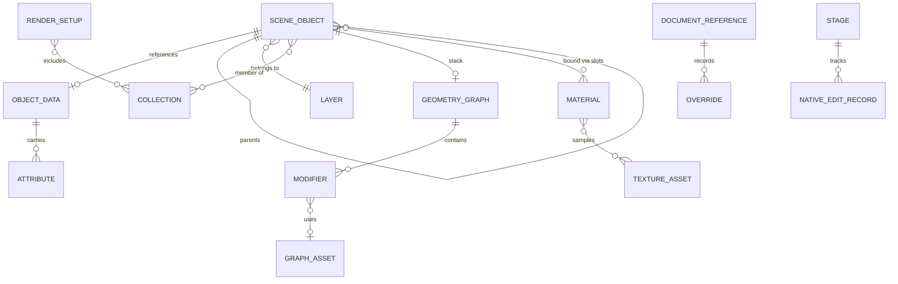

# Domain model

The object types of a MeshBuilder document, their key properties and relationships, the invariants
the model enforces, identity rules, and what recomputes when something changes. All objects live in
the `arc-doc` store with stable 128-bit identifiers and change only through commands.

## Object types

### Scene structure

| Type | Key properties | Relationships |
|---|---|---|
| Document settings | Display unit, frame rate (rational), time range, start timecode, working color space, color configuration reference, local origin, geographic reference | One per document |
| Scene object | Id, name, parent, transform channels (T, R with rotation order or quaternion, S, shear), pivot frame, inherit flags, visibility, selectability, render flags, display override, layer, user properties | Parent of scene objects; references at most one object data; member of collections; owns a geometry graph (stack) when it has geometric data |
| Object data | Kind (mesh, curve set, NURBS surface, points, volume, light, camera, empty, stage, reference proxy), payload | Shared by one or more scene objects (instance users) |
| Layer | Name, parent layer, visibility, selectability, render, display mode, color | Each scene object belongs to exactly one layer |
| Collection | Name, explicit members, member rules, instance offset | Many-to-many with scene objects; instanced by collection-instance objects; used by render setups, booleans, scatter, export presets |
| Selection set | Name, kind (objects or components), member identifiers | Component sets reference one mesh by object id plus component identifiers |
| Scene state | Name, captured property paths and values | Applies to scene objects, layers, lights, camera, environment |

### Geometry

| Type | Key properties | Relationships |
|---|---|---|
| Mesh | Half-edge topology, component identifiers, attributes on point, edge, face and corner domains, subdivision settings, material slots | Base data of a stack; may be stored as chunked assets ([ADR-0006](../adr/0006-dense-geometry-as-chunked-assets.md)) |
| Curve set | Curves of poly, Bezier or NURBS type, point and curve attributes, thickness settings; strand flag with surface attachment | Strand sets reference a surface mesh by id |
| NURBS surface | Degrees, knots, control points with weights, trim loops | Tessellated by graph nodes |
| Points | Positions and per-point attributes (including splat attributes) | Input to instancing and point nodes |
| Volume | Named sparse grids, voxel size, transform | Input and output of volume nodes and simulations |
| Attribute | Name, type, domain, interpolation rule, export and render flags | Owned by one geometry |
| Component identifier | 64-bit value per vertex, edge and face, unique within the geometry | Referenced by selection sets, recorded edits, overrides, UV copies |

### Procedural evaluation

| Type | Key properties | Relationships |
|---|---|---|
| Geometry graph | Nodes, links, published interface | Owned by a scene object (its stack) or stored as a graph asset |
| Modifier | Node with parameters, viewport and render enable, selection input | Element of a stack; may be instanced across stacks |
| Recorded edit | Operation list keyed by component identifiers | A modifier kind |
| Graph asset | Graph, interface, version, catalog metadata | Used by graph modifiers and other graphs by id and version |
| Frame cache entry | Node or object id, frame, revision, payload hash | Derived; never saved as authority |

### Look and rendering

| Type | Key properties | Relationships |
|---|---|---|
| Material | Node graph with OpenPBR surface, displacement and volume terminals | Bound to scene objects, collections or face sets through material slots and assignments |
| Texture asset | Embedded content hash or path, color space, UDIM pattern, filtering | Used by material nodes |
| Light | Kind, color, temperature, intensity with unit, shape parameters, linking sets, filters, light group | Object data of a scene object |
| Environment | Image or sky model, rotation, visibility flags | One active per scene state or render setup |
| Camera | Projection, sensor, focal length, aperture, focus, shutter, clip planes, shift, stereo settings | Object data of a scene object |
| Render settings | Resolution, frame range, camera, outputs, passes, quality preset | One default plus per render setup |
| Render setup | Collections included or excluded, overrides (target property, absolute or relative value), passes | Applies to scene objects and render settings |

### References and assembly

| Type | Key properties | Relationships |
|---|---|---|
| Document reference | Target path or Hub id, version pin, namespace, root transform, representation, overrides | Targets another `.meshb`; overrides key on target identifiers |
| Arc Scene link | Source product, source path or stream, version, refinements | Refinements key on source element identifiers |
| Stage | Root layer path, session layer, layer stack state, edit target, payload load set, population mask, time mapping | Object data of a stage object |
| Native edit record | Stage id, prim path, edit layer, created native objects | Links native objects to the prim they write back to |
| Container | Source collection, published parameter list | Referenced by document references |

### Animation, rigging, sculpting and simulation

These types are owned by the areas RIG, SKIN, ANIM, NLA, MOCAP, SCULPT, PAINT, DYN, FX and MOGRAPH.
At the object-model level they follow the same rules as everything else:

| Type | Key properties | Relationships |
|---|---|---|
| Joint, skeleton, solver chain, constraint, control | Transforms and solver settings | Graph nodes evaluated with transforms; constraints read target transforms |
| Skin binding, blend shape, deformer | Weights as attributes, targets as stored deltas keyed by component identifiers | Modifier nodes in the stack |
| Animation curve | Property path, keys with tangents, infinity modes | Drives any animatable property; evaluated with time as input |
| Clip, track, animation layer, take | Source animation, time mapping, weights | Produce property values per frame for the evaluation graph |
| Character definition, actor, marker set | Slot mapping, solver settings | Produce joint transforms from marker or device data |
| Multiresolution levels, sculpt layer | Per-level displacement chunks, layer deltas and masks | Stored as chunked assets; feed the mesh stack at a declared level |
| Texture set, paint layer | Channel images per layer with blend modes and masks | Produce texture assets consumed by materials |
| Solver, simulation zone state, cache | Solver parameters, per-frame state, cache files | Simulation zones in graphs; caches stream into evaluation |

## Invariants

1. The scene hierarchy is acyclic; parenting commands reject cycles.
2. Each scene object belongs to exactly one layer; deleting a layer moves its objects to its parent
   layer.
3. A mesh is a valid half-edge structure: every face has at least three distinct vertices, every
   half-edge has a twin or is a border, non-manifold configurations are represented through
   explicit non-manifold vertices and flagged, never silently repaired.
4. Component identifiers are unique within one geometry; no operation produces duplicates.
5. Built-in attribute names have fixed types and domains.
6. Shared object data has a user count; data with zero users is removed at save unless it is marked
   as an asset.
7. A modifier stack is a graph whose single output feeds the object's evaluated geometry; the stack
   view exists only when the graph is linear from base to output.
8. Overrides, recorded edits and selection sets reference identifiers, never indices or names.
9. Derived data (evaluated geometry, frame cache, thumbnails, render scenes) is never the authority
   and can be discarded at any time.
10. Lengths are metres and angles radians in storage; display units apply only at the UI and
    interchange boundaries.
11. Time is stored as integer ticks at 705,600,000 per second; frame numbers are derived from the
    rational frame rate.
12. A document contains no executable code that runs on open.

## Identity rules

| Item | Identity | Survives |
|---|---|---|
| Scene object, material, collection, layer, graph asset | 128-bit document id | Rename, reparent, save, reference, merge (merges remap ids on collision and record the map) |
| Component | 64-bit id within its geometry, derived deterministically from the creating operation's node id and input component ids | Upstream parameter changes and edits that keep the component; split components derive new ids from the original plus an ordinal |
| Referenced object | Reference id plus target object id | Reloads and replacements where the target id exists |
| Imported object | Document id plus stored source identifier (USD prim path, glTF node index path, FBX unique id, Alembic object path) | Reimport of an updated source |
| Arc Scene linked element | Source product's stable element id | Source updates |

Names are labels. Uniqueness of names is enforced only among siblings, for readable paths in scripts
and exports.

## Regeneration and dependency rules

| Change | Recomputes |
|---|---|
| Transform channel of an object | World matrices of the object and its descendants; constraints and deformers reading those transforms; instances of collections containing it |
| Base mesh data or a modifier parameter | That object's stack from the changed node upward; objects whose graphs read this object's geometry; booleans and scatters using it as operand |
| Graph asset version | Every graph and modifier using that asset without a version pin |
| Material graph | Viewport shader for that material; Arc Scene delta for that material only |
| Texture file on disk | Texture asset; materials sampling it |
| Layer or visibility state | Display and render inclusion only; no geometry evaluation |
| Collection membership (explicit or rule) | Collection instances, render setups, boolean and scatter operands using the collection |
| Time | Only nodes that declare time dependency (animated properties, simulation zones, time-reading nodes, cache readers) and their downstream nodes |
| Document reference reload | Referenced objects, then overrides reapplied, then dependents |
| Stage layer edit | Prims composed from the edited layer, then dependents |
| Unit display setting | Nothing in the model; only UI formatting |

Evaluation details (dirty propagation, scheduling, caching) are in [evaluation.md](evaluation.md).
