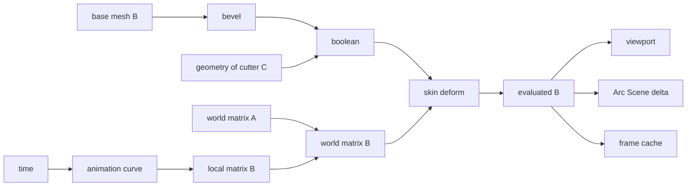

# Evaluation model

How MeshBuilder computes everything derived from the document: one dependency graph that contains
transforms, modifier stacks, geometry graphs, deformers, rigs, materials and simulations; how
changes propagate; how work is scheduled in parallel; how results are cached; how time enters; and
what determinism guarantees hold.

## One system

There is one evaluation graph per document, built on `arc-nodes` and scheduled by the `arc-doc`
regeneration scheduler. Every producer of derived data is a node:

| Source in the document | Nodes in the evaluation graph |
|---|---|
| Transform channels and parenting | Local-matrix node per object, world-matrix node per object linked to the parent's world matrix |
| Modifier stack | A chain of operation nodes from the base data node to the object's geometry output |
| Geometry graph | Its nodes, inlined into the evaluation graph with the object as context |
| Graph asset use | A reference to the asset's compiled subgraph, instantiated per use |
| Deformers, skin bindings, blend shapes | Operation nodes in the stack (owned by SKIN) |
| Constraints, solvers, drivers | Transform-producing nodes reading other objects' matrices (owned by RIG) |
| Animation curves, clips, layers | Value nodes with time as input (owned by ANIM and NLA) |
| Simulation zones | Stateful nodes with a per-frame state input from the previous frame (owned by DYN and FX) |
| Materials | Shader-compile nodes for the viewport and Arc Scene material translation nodes |
| References and stages | Loader nodes whose outputs are the referenced objects' data |

The modifier stack is not a second system: the stack editor reads and edits the linear chain of an
object's graph ([ADR-0001](../adr/0001-modifier-stack-as-graph-view.md)). A geometry operation
exists once in `meshbuilder-model` and is wrapped as a command, a modifier and a node.

## Dirty propagation

1. A committed transaction lists changed objects and property paths.
2. Each changed property maps to the nodes that read it (the read set is declared by node type, or
   recorded during the node's last evaluation for graph nodes whose reads depend on inputs).
3. Those nodes and everything downstream are marked dirty for the current revision. Propagation
   stops at nodes whose declared dependency does not include the changed property (for example a
   material change does not dirty geometry).
4. Dirty marking is cheap and synchronous; evaluation is lazy: only dirty nodes needed by a consumer
   (visible viewport content, an open render session, an export, the frame cache filler) are
   scheduled.
5. A node whose inputs evaluate to values with the same content hash as last time reuses its
   previous output and stops propagation downstream (early cutoff).

## Scheduling and parallel evaluation

- The scheduler topologically orders dirty, demanded nodes and runs ready nodes on a work-stealing
  thread pool. Independent objects evaluate concurrently from the first release.
- Data-parallel nodes (per-element operations, field evaluation, for-each zones) split their work
  into chunks across the same pool.
- Nodes are pure functions of their inputs and parameters. Nodes that need exclusive resources
  (a device, a plug-in instance without reentrancy) declare it and the scheduler serializes only
  those nodes; the profiler shows each serialization point.
- Every evaluation carries the revision it started from. A newer transaction cancels in-flight work
  that the transaction dirtied; results tagged with an old revision are discarded, never shown.
- Interactive previews evaluate on a scratch branch: the prompt machine's tentative parameters are
  applied to a copy-on-write view of the affected nodes and do not disturb committed results.
- GPU-side work (display subdivision, instancing) consumes evaluated data; evaluation itself runs on
  the CPU in the first releases. Compute-shader evaluation of selected nodes is a later optimization
  that must produce results within tolerance of the CPU path.

## Caching

| Cache | Contents | Key | Lifetime |
|---|---|---|---|
| Node output cache | Last output of each node | Node id, input content hashes | Until inputs change or memory pressure evicts |
| Frame cache | Evaluated geometry and transforms per object per frame | Object id, frame tick, revision of the inputs that matter | Within a memory budget; invalidated per object and frame range |
| Simulation state cache | Per-frame state of simulation zones | Zone id, frame, upstream hash | Until upstream changes or reset; can be written to disk |
| Disk caches | Baked results (Alembic, OpenVDB, native cache assets) | File and frame | Explicit user bake; read by cache loader nodes |
| Shader cache | Compiled viewport shaders | Material graph hash, GPU feature set | Persistent on disk per machine |

Cached playback ([ADR-0005](../adr/0005-time-as-evaluation-input-and-frame-cache.md)):

1. During idle time and playback, a filler evaluates frames ahead of and behind the current frame
   in the background and stores results in the frame cache.
2. An edit invalidates only the cache entries of objects whose time-varying inputs were dirtied, and
   only for affected frames (an edit to a key between frames 10 and 20 invalidates the object from
   the earliest frame the curve change affects).
3. Playback reads from the cache when an entry for the current revision exists, and otherwise
   evaluates; the timeline shows filled, stale and empty ranges.
4. When the budget is reached, entries furthest from the current frame are evicted first.

## Time as an input

- Scene time is an explicit input node. Nodes declare whether they depend on time; only
  time-dependent nodes and their downstream nodes re-evaluate when the frame changes.
- Time is stored as integer ticks at 705,600,000 per second, which divides evenly by all common
  integer and fractional frame rates; frame numbers and sub-frame sample times derive from the
  rational frame rate without floating-point drift.
- Motion blur and simulation substeps request evaluation at sub-frame tick values; such evaluations
  use the same graph and caches keyed by tick.
- Simulation zones read the previous frame's state; evaluating frame N requires frame N-1 state,
  which comes from the state cache or forces sequential evaluation from the last cached frame. Jumps
  backward beyond the cache restart from the zone's start frame.

## Determinism

- The same document, inputs and tick produce bit-identical results regardless of thread count,
  scheduling order or machine, on all supported platforms.
- Parallel reductions use fixed chunk boundaries and a fixed combination order.
- Random operations take explicit seeds; per-element randomness hashes the seed with the element's
  component identifier, so results do not change when unrelated elements are added.
- Floating-point code avoids platform-dependent fused or approximate operations in evaluation paths;
  transcendental functions come from a deterministic implementation.
- Plug-in nodes run in a WebAssembly sandbox with deterministic floating-point settings; non-
  deterministic host calls are not available to evaluation nodes.
- CI evaluates reference documents on every platform and compares geometry hashes per frame.

## Failure handling

- A node that fails returns an empty result of its output type with an error attached; downstream
  nodes evaluate on the empty result and the error is shown on the node, the modifier and the object.
- Repeat zones and recursion have hard iteration and depth limits enforced by the engine.
- Evaluation memory is bounded per node; a node that exceeds its budget fails rather than exhausting
  the machine.
- Cycles are rejected when the graph is edited (parenting, constraints, graph links); if a cycle is
  introduced through references, the reference load fails with a message naming the cycle.
