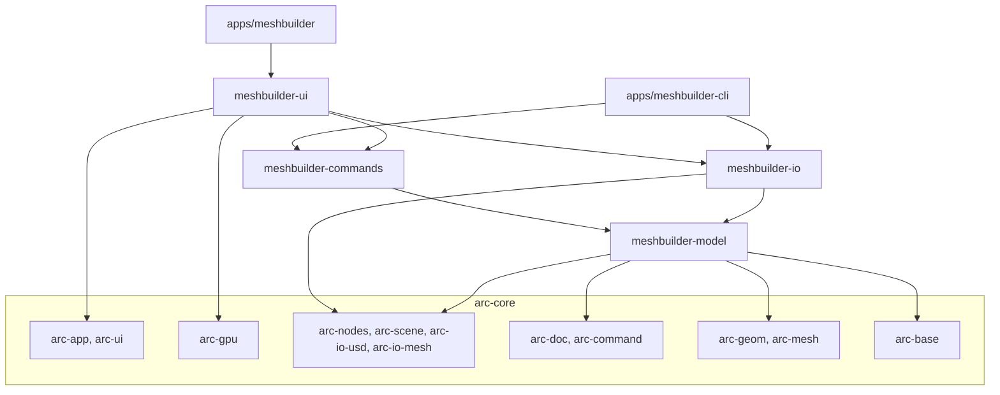
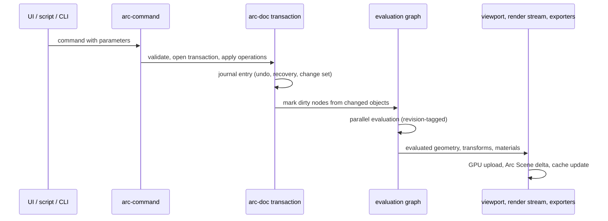

# Architecture overview

How MeshBuilder is built on `arc-core`: the crates of this repository, the runtime flows, the
product-specific subsystems, threading, performance targets, the automation surface and the testing
strategy. Suite-wide decisions are in the
[suite ADRs](https://github.com/ACKaraca/arc-suite/tree/main/docs/adr).

## Crates

| Crate | Layer | Responsibility |
|---|---|---|
| `meshbuilder-model` | headless, L3-level | Domain objects ([domain model](domain-model.md)), component identity, the geometry operation library used by commands, modifiers and graph nodes, evaluation node types, attribute rules |
| `meshbuilder-commands` | headless | User-level commands on the model with parameter schemas; prompt machines for interactive tools |
| `meshbuilder-io` | headless | Mapping between the domain model and interchange formats; USD stage hosting and native edit mapping ([scene and USD](scene-and-usd.md)) |
| `meshbuilder-ui` | UI | Tools, editors (outliner, graph editor, UV editor, layer stack editor, render view), manipulators, viewport interaction |
| `apps/meshbuilder` | app | Desktop application wiring |
| `apps/meshbuilder-cli` | app | Headless CLI: convert, validate, evaluate graphs, capture, run commands, serve the automation protocol |

New crates are added only for a real second boundary. Expected triggers: a `meshbuilder-sim` crate
when the first solver lands (solvers have their own numerical test suites and release cadence), and
a device-input crate when live motion-capture devices need platform-specific code. The FBX bridge is
a separate executable outside the main build ([ADR-0004](../adr/0004-fbx-through-isolated-bridge.md)).

## Use of `arc-core`

| Crate | Used for |
|---|---|
| `arc-base` | Identifiers, units and quantities (metres, radians), tolerances, colors, errors |
| `arc-geom` | Curves, NURBS curves and surfaces, intersections, planar regions for curve booleans and fills, spatial indexes |
| `arc-mesh` | Half-edge polygon mesh, attributes, subdivision surfaces, mesh booleans, simplification |
| `arc-solve` | Expression engine for driven parameters and the graph expression node |
| `arc-doc` | Document store, transactions, operation journal, dependency graph and regeneration scheduler, external references, package storage and assets |
| `arc-command` | Command registry, parameter schemas, prompt machines, macro recording, automation protocol endpoint, headless runner |
| `arc-nodes` | Typed dataflow engine for geometry graphs, modifier stacks, material graphs, rigs and simulation zones |
| `arc-scene` | Arc Scene description and streaming to RenderBuilder; OpenPBR material model |
| `arc-io-usd`, `arc-io-mesh`, `arc-io-step`, `arc-io-dxf`, `arc-io-dwg`, `arc-io-ifc`, `arc-io-pointcloud` | Neutral format models; MeshBuilder owns the mapping in `meshbuilder-io` |
| `arc-hub-api` | File versioning, production tracking context, render queue submission, multi-user change sets |
| `arc-gpu` | Viewport rendering, picking, GPU subdivision and instancing, overlays |
| `arc-ui`, `arc-app` | Docking workspace, viewport widget, node editor, property grid, outliner, theming, settings, localization, plug-in loading, assistant panel |

Alembic, OpenVDB, MaterialX documents, OpenColorIO, OpenSubdiv-compatible evaluation and Ptex are
consumed through format and library crates that meet the dependency policy; where a needed library
is not on the license allowlist it is isolated per ADR-0009.

## Runtime flows

1. **Command to transaction.** Every change, from a manipulator drag to a script call, is a command
   that validates parameters and applies element-level operations in one transaction. A fault inside
   a command rolls the transaction back.
2. **Transaction to evaluation.** The transaction reports changed objects and properties; the
   evaluation graph marks dependent nodes dirty and schedules them ([evaluation](evaluation.md)).
3. **Evaluation to views.** Evaluated results carry the document revision; the viewport, the Arc
   Scene stream to RenderBuilder, the frame cache and open editors consume only results matching the
   current revision.
4. **Interactive tools.** A tool runs a prompt machine that previews results by evaluating the
   command on a scratch branch of the evaluation graph and commits one transaction at the end.

## Product-specific subsystems

| Subsystem | Location | Notes |
|---|---|---|
| Geometry operation library | `meshbuilder-model` | One implementation per operation, called by commands, modifier nodes and graph nodes |
| Component identity | `meshbuilder-model` | Identifier generation and propagation rules ([ADR-0002](../adr/0002-stable-component-identity.md)) |
| Modifier stack view | `meshbuilder-model`, `meshbuilder-ui` | Linear projection of an object's geometry graph ([ADR-0001](../adr/0001-modifier-stack-as-graph-view.md)) |
| Frame cache | `meshbuilder-model` on `arc-doc` | Per-frame evaluated results with memory budget ([ADR-0005](../adr/0005-time-as-evaluation-input-and-frame-cache.md)) |
| Dense data storage | `meshbuilder-model` on `arc-doc` assets | Chunked content-addressed geometry and sculpt layers ([ADR-0006](../adr/0006-dense-geometry-as-chunked-assets.md)) |
| USD stage host | `meshbuilder-io` | Stage objects, layer editing, native edit mapping ([scene and USD](scene-and-usd.md)) |
| Render integration | `meshbuilder-io` on `arc-scene` | Arc Scene export and incremental streaming to RenderBuilder |
| Retopology and UV solvers | `meshbuilder-model` | Unfold, pack, quad remesh; numerical code with dedicated tests |

## Threading and background work

- The UI thread handles input, layout and drawing only; it never evaluates geometry.
- Evaluation runs on a work-stealing thread pool sized to the machine; independent nodes run in
  parallel and data-parallel nodes split work internally.
- Long tasks (imports, exports, bakes, cache fill, thumbnail rendering, library indexing) run as
  cancellable background jobs with progress reporting; their results are applied as transactions or
  attached as revision-tagged derived data.
- GPU work (subdivision display, instancing, picking) is submitted by the viewport from evaluated
  data; no model state lives only on the GPU.
- RenderBuilder and the FBX bridge are separate processes; their failure never affects the document.

## Performance targets

| Target | Value | Rationale |
|---|---|---|
| Viewport frame rate while navigating | 60 frames per second for 10 million displayed triangles on a mid-range GPU | Interactive navigation is the most frequent action |
| Modeling command latency | Under 50 ms from release to updated display for a 100,000-face mesh | Perceived as immediate |
| Modifier parameter drag | Updated result at 30 frames per second for a 5-modifier stack on a 100,000-face mesh | Parameter tuning is done by dragging |
| Playback from frame cache | Scene frame rate for any scene whose cache fits the budget | Animation review needs real time |
| Document open to first view | Under 3 s for a 2 GB document | Partial loading of dense assets defers bulk data |
| Outliner | Under 16 ms per frame with one million objects | Virtualized tree |
| Parallel scaling | At least 70 percent efficiency at 16 cores on a scene of 100 independent deforming objects | Evaluation must use the machine |

Targets are verified by benchmark scenes in CI; regressions beyond 10 percent fail the benchmark job.

## Automation surface

- **Commands**: every action is a registered command ([17-scripting-and-extensibility](../product/capabilities/17-scripting-and-extensibility.md)).
- **Arc Automation Protocol**: JSON-RPC over stdio or a local socket; document queries, command
  execution, event subscriptions, evaluated-geometry queries.
- **CLI**: `meshbuilder-cli` for conversion, validation, graph evaluation, capture and protocol
  serving.
- **Node graphs**: geometry, material, rig and simulation graphs on `arc-nodes`.
- **Plug-ins**: sandboxed WebAssembly modules contributing commands, modifiers, nodes, importers,
  exporters and manipulators.
- **Model Context Protocol endpoint**: derived from the registry for assistants.

## Testing strategy

| Test kind | Scope |
|---|---|
| Operation tests | Each geometry operation on reference meshes: topology counts, attribute propagation, component identity preservation, tolerance-bounded positions |
| Property tests | Randomized meshes through operation sequences: validity invariants, no panics, determinism |
| Golden hashes | Evaluated geometry hashes of reference documents per frame, compared across thread counts and platforms |
| Interchange round trips | Export and re-import through independent readers (glTF validator, USD reader, Alembic reader) with loss-report checks |
| Fuzzing | Every importer, the document loader and the automation protocol parser |
| Viewport image tests | Reference renders of display modes and overlays compared with tolerance |
| Workflow tests | The [reference workflows](../product/workflows.md) scripted through the automation protocol, headless |
| Benchmarks | The performance targets above |
